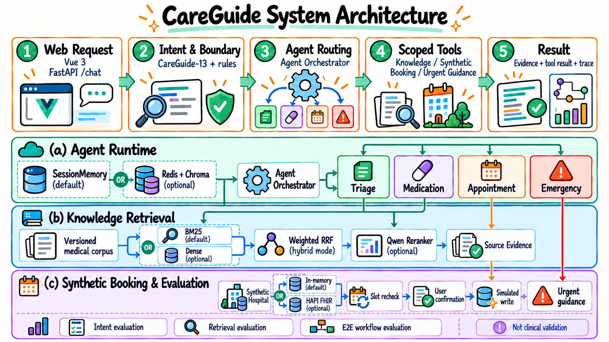

# CareGuide

**医疗信息检索与模拟预约 Agent**

CareGuide 是一个用于医疗资料查询和预约流程演示的 Agent 项目。用户可以在网页中提问并查看回答所依据的资料，也可以查询合成医院里的科室、医生和号源，在确认后模拟创建、改期或取消预约。

系统采用 Orchestrator–Workers 架构：独立轻量理解层结合规则、CareGuide-13 本地 RoBERTa 候选和业务示例语义检索，提取目标及参数；主编排器管理计划，分诊、用药、预约及急症提示角色各自处理职责内任务。知识检索默认使用 BM25，也可启用 Dense 检索、加权 RRF 和 Qwen Reranker。项目不连接真实医院，也不使用真实患者数据；检索资料未经临床审核，不用于诊断、处方或个体化剂量建议。

## 系统架构



可编辑的请求流程图：[查看 Mermaid 源文件](figures/careguide-runtime.mmd)。

默认 `unified` 模式中，明确单任务、已知独立组合及医生→号源流程由程序生成计划；未知目标、关系、指代或修改由主 Agent 一次理解并提出计划。所有计划统一校验权限、参数和 DAG，再由 LangGraph 流程与调度器执行。子 Agent 接收独立 TaskBrief，返回结构化结果，通过编排器传递依赖。支持等待补参、局部变更、跨进程恢复、累计预算及原有预约确认。配置与验收证据见 [编排架构与运行说明](docs/orchestration/implementation.md) 和 [验收矩阵](docs/orchestration/acceptance.md)。上图展示角色与后端概览，详细入口以编排说明为准。

网页聊天使用 `POST /chat/stream` SSE，展示阶段、任务进度及模型正文增量；保留 `/chat` JSON 接口。通用就诊准备、普通概念和表达整理可由模型直接回答，标注一般信息，不要求知识库命中，也不生成业务任务 DAG。具体医院规定、药品资料和业务操作仍由检索或工具提供依据；查询有结果时，回答 Agent 根据工具结果组织带来源的自然语言。生成中的文字是未完成草稿；正常结束并通过对应检查后，以完整最终结果替换。超时、断流或引用无效则撤回草稿；检索路径保留程序整理的查询结果，直接回答路径展示具体失败提示。停止接收后可恢复会话查看任务状态，系统不会因断线自动重发业务请求。

回答支持安全 Markdown、引用定位和分阶段耗时；可选 Bearer token 将用户身份绑定到服务端。回答忠实度探针、原 RoBERTa／业务 embedding 的小规模对比和接入说明见 [质量与访问说明](docs/orchestration/quality-and-ui.md)。这些工程验证不代表临床有效性或总体意图识别准确率。

## 仓库结构

| 路径 | 内容 |
| --- | --- |
| `careguide/` | API、路由编排、Agent、工具、检索、记忆与评测实现 |
| `frontend/` | Vue 3 界面 |
| `data/` | 版本化资料、合成医院数据集和冻结评测摘要 |
| `scripts/` | 服务启动、语料构建、索引、训练与评测入口 |
| `tests/` | 单元测试、契约测试与工作流回归 |

## 快速开始

需要 Python 3.12。默认配置使用 BM25、进程内会话记忆和内存合成医院；基础模式不需要模型 API 密钥。

动态规划和自然语言回答需要配置兼容 Chat Completions 的模型。公开配置默认 `mimo-v2.6-flash`；其他兼容服务可显式覆盖模型及地址。已知医生＋药品组合及医生→号源→确认模板支持无模型运行；原分类模型路径沿用 `CAREGUIDE_QIC_MODEL_PATH`。分类或语义分数只作线索，未启用未经校准的直接接受。以下示例不需要密钥：

业务意图检索复用原 `CAREGUIDE_EMBEDDING_*` 硅基流动配置，默认 `CAREGUIDE_INTENT_SEMANTIC_MODE=auto`：有 embedding 密钥且配置了主模型时，未知请求按需检索；缺少配置、超时或预算不足则保留本地候选并降级。设置 `local_ngram` 可保持意图候选离线。业务示例索引与医疗 RAG 索引、CareGuide-13 类别中心分别管理，不会重建原索引。设置和评测命令见编排说明。

```bash
python scripts/reproduce_unified.py --scenario compose
python scripts/reproduce_unified.py --scenario template
python scripts/reproduce_unified.py --scenario wait
python scripts/reproduce_orchestration.py --scenario dependency
python scripts/reproduce_orchestration.py --scenario replan
python scripts/reproduce_orchestration.py --scenario wait
python scripts/reproduce_orchestration.py --scenario partial
python scripts/reproduce_orchestration.py --scenario memory
```

`reproduce_unified.py` 使用本地组合／模板和真实 worker，无模型调用；`reproduce_orchestration.py` 验证兼容模式，使用可控 Planner 响应和真实调度／业务代码。这些示例不衡量真实模型的规划准确率或线上费用。

```bash
python -m venv .venv
# Windows PowerShell: .venv\Scripts\Activate.ps1
# Linux/macOS: source .venv/bin/activate
python -m pip install -r requirements-semantic.txt
cp .env.example .env
python -m scripts.serve --config-file .env --host 127.0.0.1 --port 8010
```

PowerShell 中可用 `Copy-Item .env.example .env` 代替 `cp`。API 地址为 <http://127.0.0.1:8010>，健康检查为 <http://127.0.0.1:8010/health>。

启动前端：

```bash
cd frontend
npm ci
npm run dev
```

Docker 完整模式：

```bash
docker compose --env-file .env \
  -f docker-compose.yml -f docker-compose.full.yml \
  -f docker-compose.integrations.yml \
  --profile memory --profile integrations up -d --build
```

Dense/Hybrid 检索需要配置 Embedding 服务并显式建立版本化 Chroma 索引；Reranker 和 Transformer 模式也需要各自的模型服务或本地 checkpoint。模型权重和 API 密钥不随仓库发布，配置模板见 [`.env.example`](.env.example)。

## 评测结果

| 任务 | 评测集 | 结果 |
| --- | --- | --- |
| 意图识别 | 1,097 条冻结测试集；RoBERTa-wwm-ext | Accuracy 83.77%；Macro-F1 83.66% ([评测说明](data/eval/careguide_intent_v4/README.md)) |
| RAG 检索 | 1,000 条冻结测试集 | MRR@10 0.4857；Recall@10 0.6680；nDCG@10 0.5292 ([评测说明](data/eval/careguide_kuake_rag_v1/README.md)) |
| 端到端开发集 | 60 条合成工作流 | 确定性任务通过率 100%；Judge overall 0.9273 |
| 端到端固定契约回归 | 60 条合成工作流 | 确定性任务通过率 88.33%；证据正确率 80%；Judge overall 0.9015 ([冻结摘要](data/eval/careguide_e2e_v1/frozen_provider_heldout_result_v4.json)) |

各项结果来自不同评测任务，不能合并为“医疗准确率”。固定契约回归集曾在离线开发中运行过，不是全新未见测试集；评测未验证临床有效性。数据划分、模型配置和哈希见对应目录中的清单文件。

## 数据与范围

项目中的医院、医生、号源和预约均为合成数据。公开健康资料和 KUAKE 派生语料未经 CareGuide 临床审核；检索分数不代表临床正确性。第三方数据、模型和代码的来源及许可见 [`NOTICE.md`](NOTICE.md)。
