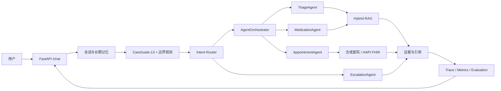

# CareGuide · 医疗咨询与合成预约 Agent

CareGuide 是一个医疗咨询与合成预约 Agent 项目，包含意图识别、RAG、工具调用、分层记忆、模拟预约和评测。

用户输入问题后，路由器先判断意图和边界，再由编排器选择分诊、用药、预约或急症处理角色。知识问题会检索资料，
预约相关操作只在合成医院中运行。

> 项目没有接入真实医院或患者数据，不能用于诊断、处方、个体化剂量建议或真实挂号。

## 项目里有什么

- **意图路由**：CareGuide-13 分类、动作解析和规则一起决定交给哪个角色处理。
- **RAG**：BM25、Qwen Embedding、加权 RRF 和 Qwen Reranker 组成混合检索。
- **模拟预约**：可以查询医生和号源，也可以创建、改期、取消和查询模拟预约；写操作需要用户确认。
- **记忆**：Redis 保存最近对话和摘要，Chroma 保存跨会话记录与用户偏好。
- **工具调用**：每个角色有自己的工具列表，并处理参数校验、超时、缓存、熔断和幂等。
- **运行记录和评测**：保存请求与动作 Trace，并分别评测意图识别、RAG 和端到端回答。

## 系统架构



项目使用**集中式路由和编排**。识别器先给出语义意图、动作、实体和边界状态，`AgentOrchestrator` 根据结果选择
处理角色和执行顺序。每个角色只会拿到自己需要的工具。

| 角色 | 职责 | 主要工具 |
|---|---|---|
| `TriageAgent` | 一般症状资料、科室导航、就诊准备和复诊资料 | 资料检索、科室查询 |
| `MedicationAgent` | 指定药品说明书、禁忌、注意事项和已收录相互作用 | 药品标签、相互作用查询 |
| `AppointmentAgent` | 医院、医生、号源与合成预约状态机 | 医生、Slot、Appointment 工具 |
| `EscalationAgent` | 当前急症信号的优先提示 | 无外部执行工具 |

## 一条消息怎么处理

```text
读取记忆 → 识别意图和边界 → 选择角色 → 选择 Skill → 调用工具
         → 得到资料或操作结果 → 组织回答 → 写入 Trace 和记忆
```

例如用户询问“头痛应该挂什么科”，路由器会选择 `TriageAgent` 并检索相关资料。之后询问“明天下午有号吗”，
系统会选择 `AppointmentAgent` 查询合成 Slot。用户选择号源后，系统先生成十五分钟有效的确认卡；收到确认后再检查
一次 Slot，写入模拟预约并记录变化。

## 主要实现

### 意图识别

- **CareGuide-13**：KUAKE-QIC 11 类，加 `appointment_action` 与 `emergency`。
- 数据集共 7,331 条：5,132 train、1,102 validation、1,097 frozen test。
- 完整模式使用微调的 `hfl/chinese-roberta-wwm-ext`；没有 GPU 时可以用 CPU 运行。
- 轻量模式保留字符 TF-IDF、Qwen centroid、规则与受控 LLM gate。
- Transformer 只负责语义分类；动作解析、实体抽取、安全边界和工具权限由后续确定性流程处理。

### RAG

- 运行时语料包含 10,000 条 KUAKE-IR 固定切片和 15 条有来源的公众健康、药品资料。
- BM25 与 Dense 各取 Top 100，以 Dense:BM25=`4:1` 加权 RRF 融合，再对前 20 条使用
  `Qwen/Qwen3-Reranker-0.6B` 精排。
- Dense 使用 `Qwen/Qwen3-Embedding-0.6B`，向量存入版本化 Chroma Collection。
- 医院、院区、科室、药品规格和资料有效期在工具层再次校验；排序分数不代表临床正确性。

### 记忆与状态

- `SessionMemory`：无需外部服务的进程内会话记忆。
- Redis：最近消息和会话摘要。
- Chroma `episodic`：跨会话情景记忆。
- Chroma `user_profile`：长期偏好和稳定实体。
- HAPI FHIR：合成 `Practitioner`、`Schedule`、`Slot` 和 `Appointment`。

历史记忆作为对话背景使用。创建、改期和取消会记录用户、会话、参数摘要和幂等键，确认动作十五分钟内有效，
执行前还会重新检查 Slot。

## 评测结果

| 模块 | 数据与配置 | 结果 |
|---|---|---|
| 意图识别 | 1,097 条 frozen test；RoBERTa-wwm-ext | Accuracy **83.77%**，Macro-F1 **83.66%** |
| 预约与急症小类 | 同一 frozen test | Appointment F1 **94.92%**，Emergency F1 **96.67%** |
| RAG | 1,000 条 frozen test；4:1 RRF + Qwen Reranker | MRR@10 **0.4857**，Recall@10 **0.6680**，nDCG@10 **0.5292** |
| E2E dev | 60 条；MiMo 工具循环 + 独立 DeepSeek Judge | 确定性任务 **100%**，Judge overall **0.9273** |
| E2E 固定契约回归 | 60 条；相同 provider 配置 | 确定性任务 **88.33%**，Judge overall **0.9015** |

意图、检索和端到端结果来自不同任务，不能合并成一个“医疗准确率”。端到端结果用于检查知识查询、
模拟预约和安全边界，不代表临床正确性。

## 快速开始

### 本地轻量模式

需要 Python 3.12。

```bash
python -m venv .venv
# Windows: .venv\Scripts\activate
# Linux/macOS: source .venv/bin/activate
pip install -r requirements-semantic.txt -r requirements-dev.txt
cp .env.example .env
python -m pytest -q -p no:cacheprovider
python -m scripts.serve --config-file .env --host 127.0.0.1 --port 8010
```

Windows PowerShell 可使用 `Copy-Item .env.example .env`。默认配置使用 BM25、fusion 意图分类、SessionMemory 和
内存合成医院；不填写模型密钥也能运行基础流程。前端启动方式：

```bash
cd frontend
npm ci
npm run dev
```

- API：<http://127.0.0.1:8010>
- 前端：<http://127.0.0.1:5175>
- 健康检查：<http://127.0.0.1:8010/health>

### Docker 完整模式

```bash
cp .env.example .env
docker compose --env-file .env \
  -f docker-compose.yml \
  -f docker-compose.full.yml \
  -f docker-compose.integrations.yml \
  --profile memory --profile integrations up -d --build
```

首次使用 Hybrid RAG 前，需要配置 Embedding API 并建立版本化 Chroma 索引：

```bash
docker compose --env-file .env \
  -f docker-compose.yml -f docker-compose.full.yml \
  --profile memory run --rm careguide \
  python -m scripts.index_medical --apply --versioned \
  --corpus-dir /app/data/careguide_kuake_rag_v1
```

RoBERTa checkpoint 不进入 Git。准备好本地 checkpoint 后，在 `.env` 设置 `CAREGUIDE_QIC_MODEL_HOST_PATH`，
并额外叠加 `docker-compose.transformer.yml`。该模式在无 GPU 主机上固定使用 CPU 推理。

## 配置与接口

公开配置模板见 [`.env.example`](.env.example)。密钥只放在 `.env` 或部署环境变量中；`.env`、模型权重、
Chroma 数据、Trace 和运行结果均被 Git 忽略。

主要接口：

- `POST /chat`
- `GET /health`、`GET /capabilities`
- `GET /actions/{id}`、`POST /actions/{id}/confirm`、`POST /actions/{id}/reject`
- `GET /appointments`
- `POST /search`
- `GET /trace/tool/{request_id}`
- `GET /monitor`、`GET /metrics`

## 仓库结构

```text
careguide/       核心运行时、路由器、Agent、RAG、记忆、FHIR 与评测代码
frontend/        Vue 3 前端
data/            版本化语料、合成医院、数据集与冻结结果
scripts/         数据构建、训练、评测、索引和验收入口
tests/           单元、契约与工作流回归测试
```

## 数据与参考

- [CBLUE / KUAKE](https://github.com/CBLUEbenchmark/CBLUE)：意图识别与检索数据，Apache-2.0。
- [Huatuo26M-Lite](https://huggingface.co/datasets/FreedomIntelligence/Huatuo26M-Lite)：开放医疗问答样本，Apache-2.0。
- [WeKnora](https://github.com/Tencent/WeKnora)：可选知识服务接口，MIT。
- [H-AdminSim](https://github.com/ljm565/H-AdminSim)：合成医院与预约场景参考，Apache-2.0。
- [HAPI FHIR](https://github.com/hapifhir/hapi-fhir-jpaserver-starter)：合成医院的 FHIR 服务，Apache-2.0。
- [PatientAgentBench](https://github.com/amazon-science/PatientAgentBench)：端到端评测维度参考，CC BY-NC 4.0；未复制其代码和数据。

第三方材料说明见 [NOTICE.md](NOTICE.md)。KUAKE 派生语料未经临床审核；项目中的医生、号源和预约均为模拟数据。
